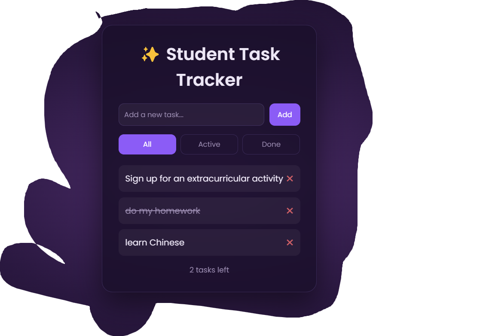

# ✨ Student Task Tracker

🔗 **Live demo:** [tmwanza4.github.io/Student-task-tracker](https://tmwanza4.github.io/Student-task-tracker/)



A clean, simple task tracker for students, built with React and Vite. Add your tasks, tick them off as you go, and pick up where you left off, because your list is saved in the browser.

## Features

- Add new tasks quickly with the input form
- Click a task to mark it as completed (or undo it)
- Double-click a task to edit it (Enter to save, Esc to cancel)
- Delete tasks you no longer need
- Filter tasks by All, Active or Done
- See how many tasks you have left at a glance
- Tasks are saved automatically in `localStorage`, so they survive page refreshes
- Dark purple theme with a glass-style card and smooth animations

## Tech Stack

- [React](https://react.dev/) (hooks: `useState`, `useEffect`)
- [Vite](https://vitejs.dev/) for the dev server and build
- Plain CSS with custom properties for theming
- [gh-pages](https://www.npmjs.com/package/gh-pages) for deployment to GitHub Pages

## Getting Started

### Prerequisites

- [Node.js](https://nodejs.org/) 18 or newer
- npm (comes with Node.js)

### Installation

```bash
# Clone the repository
git clone https://github.com/Tmwanza4/Student-task-tracker.git

# Move into the project folder
cd Student-task-tracker

# Install dependencies
npm install

# Start the development server
npm run dev
```

Then open the local address shown in the terminal (usually `http://localhost:5173/Student-task-tracker/`).

### Build for production

```bash
npm run build
npm run preview
```

### Deploy to GitHub Pages

```bash
npm run deploy
```

## Project Structure

```
Student-task-tracker/
├── public/          # Static assets
├── screenshots/     # README images
├── src/
│   ├── App.jsx      # Main component: task logic and UI
│   ├── index.css    # Global styles and theme
│   └── main.jsx     # App entry point
├── index.html
├── package.json
└── vite.config.js
```

## Roadmap

- [x] Filter tasks by All / Active / Completed
- [x] Show a "tasks left" counter
- [x] Edit existing tasks
- [x] Dark mode
- [ ] Add due dates to tasks
- [ ] Highlight overdue tasks

## Author

**Taizya**
Computer Science student, Mulungushi University
GitHub: [@Tmwanza4](https://github.com/Tmwanza4)